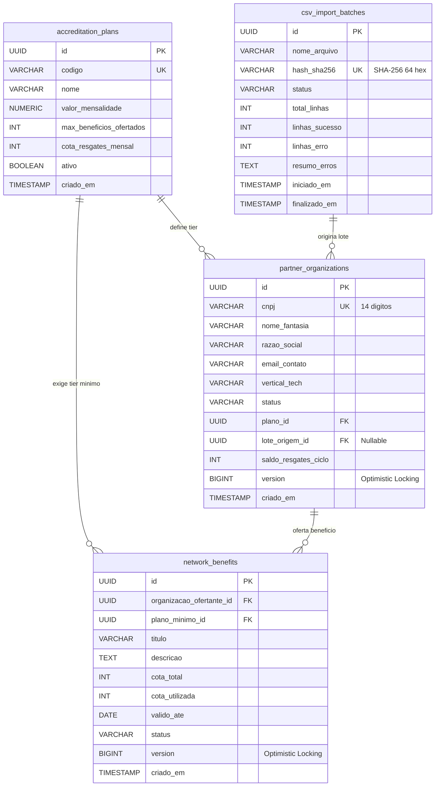
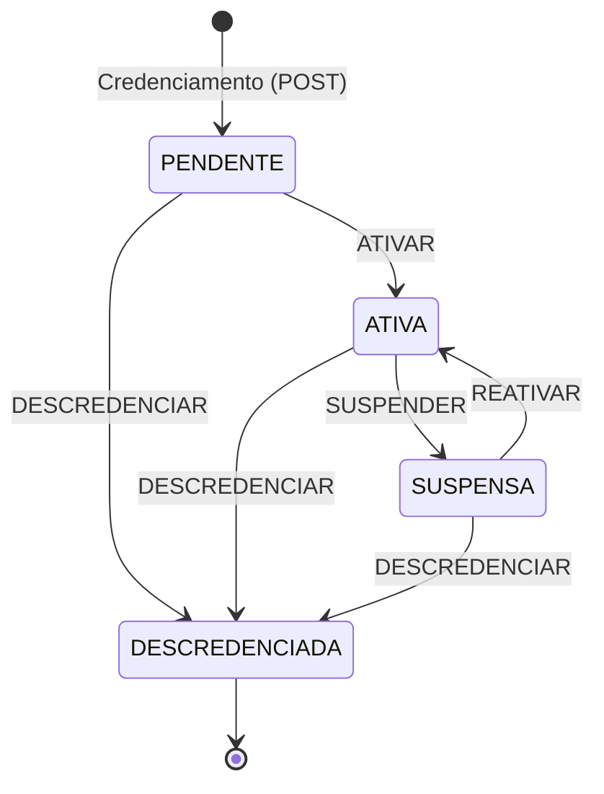
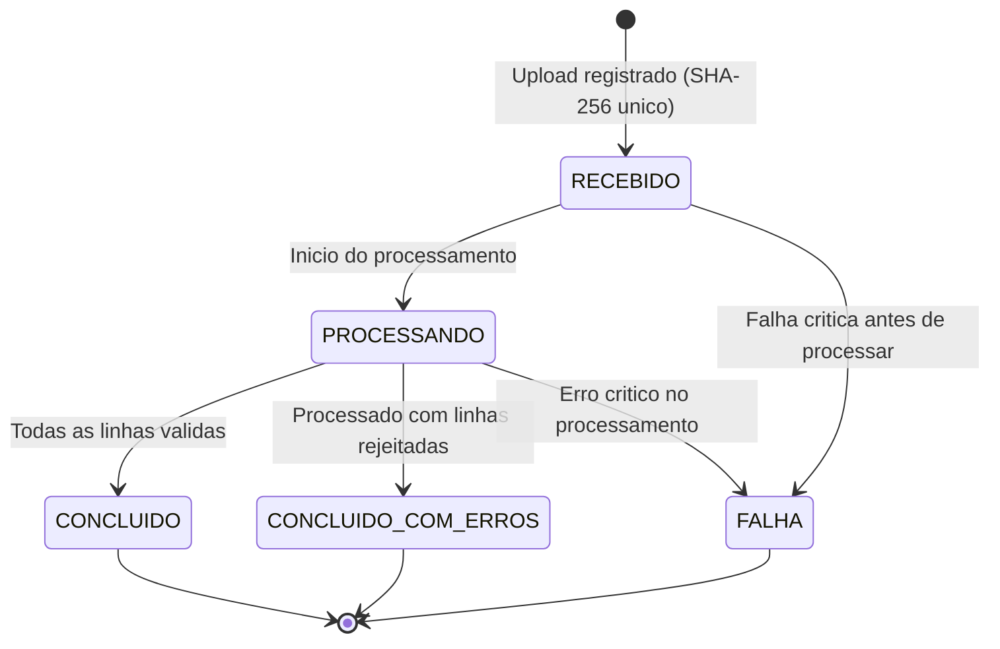

# 🚀 NexusHub API


Motor Back-end B2B (**SaaS API-First**) projetado para **Polos de Inovação, Parques Tecnológicos e Redes de Empresas Parceiras**. A plataforma gerencia o credenciamento de startups e empresas por níveis (*tiers*), o catálogo de benefícios B2B cruzados com proteção transacional contra *over-claim* (`@Version`) e o rastreamento idempotente de lotes de importação CSV (`SHA-256`).

---

## ✨ Principais Diferenciais de Engenharia

- **Tiers de Credenciamento (`PlanoCredenciamento`):** Modelagem de planos (`SEED`, `GROWTH`, `CORPORATE`) com definição de mensalidade, limite máximo de ofertas ativas (`maxBeneficiosOfertados`) e cota mensal de resgates (`cotaResgatesMensal`).
- **Credenciamento & Ciclo de Vida (`OrganizacaoParceira`):**
  - Validador customizado `@Cnpj` com cálculo dos dígitos verificadores, rejeição de sequências de dígitos repetidos e sanitização automática para 14 dígitos numéricos.
  - Busca paginada dinâmica com **JPA `Specification`** (`verticalTech`, `status`, `planoId`, `nome`), ordenação padrão por `criadoEm desc` e limite máximo de `size = 50` por página.
  - Máquina de estados estrita (`PENDENTE`, `ATIVA`, `SUSPENSA`, `DESCREDENCIADA`).
- **Controle de Concorrência Otimista (`@Version` em `BeneficioRede`):**
  - Proteção contra *over-claim* em resgates simultâneos, mapeando `ObjectOptimisticLockingFailureException` para `HTTP 409 Conflict`.
  - Validação de elegibilidade por tier mínimo (comparação de mensalidade entre plano da organização resgatante e `planoMinimo` do benefício), limite de benefícios ativos por organização ofertante e bloqueio de autorresgate.
- **Idempotência de Lotes CSV (`SHA-256` em `LoteImportacaoCsv`):**
  - Cálculo determinístico de checksum hexadecimal (`64` caracteres) sobre o conteúdo do arquivo para impedir reprocessamentos duplicados (`HTTP 409 Conflict`).
  - Máquina de estados do lote (`RECEBIDO` -> `PROCESSANDO` -> `CONCLUIDO` | `CONCLUIDO_COM_ERROS` | `FALHA`) e endpoints paginados de monitoramento/polling.
- **Padrões Corporativos Java 21:**
  - DTOs imutáveis com **Java 21 `record`**, **Virtual Threads** habilitadas (`spring.threads.virtual.enabled=true`), migrações SQL versionadas no **Flyway** (`V1`–`V3`) com `ddl-auto: validate`, respostas de erro padronizadas pela **RFC 7807 (`ProblemDetail` / `application/problem+json`)** e documentação interativa via **Swagger UI**.

---

## 🏗️ Arquitetura & Modelo de Domínio

### Diagrama Entidade-Relacionamento (ERD)



### Máquinas de Estado do Domínio

#### Ciclo de Vida de `OrganizacaoParceira`



#### Ciclo de Vida de `LoteImportacaoCsv`



---

## 🛠️ Stack Tecnológica & Estrutura do Projeto

| Camada | Tecnologia / Ferramenta | Uso no Projeto |
| :--- | :--- | :--- |
| **Linguagem & Runtime** | Java 21 LTS | Records nos DTOs e Virtual Threads habilitadas |
| **Framework** | Spring Boot 3.3.5 | Web, Data JPA, Bean Validation, Cache, Async & Scheduling |
| **Persistência** | PostgreSQL 16 + Hibernate | Banco relacional principal com `ddl-auto: validate` |
| **Migrações SQL** | Flyway (`V1`–`V3`) | Controle estrito de schema e índices compostos de performance |
| **Cache Distribuído** | Redis 7 (`redis:7-alpine`) | Infraestrutura provisionada para cache de catálogos e planos |
| **Documentação API** | SpringDoc OpenAPI `2.5.0` | Especificação OpenAPI 3 (`/v3/api-docs`) e Swagger UI |
| **Testes** | JUnit 5, Mockito, MockMvc & H2 | Testes unitários, integração REST, contrato RFC 7807 e concorrência |
| **Orquestração Local** | Docker Compose | Serviços `nexushub-postgres` e `nexushub-redis` com healthchecks |

### Organização de Pacotes

```text
nexushub-api
├── docker-compose.yml
├── docs/
│   └── api-organizacoes.md
└── src/
    ├── main/
    │   ├── java/com/alissondev/nexushub/
    │   │   ├── NexusHubApplication.java
    │   │   ├── config/          # OpenApiConfig
    │   │   ├── controller/      # Health, Planos, Organizacoes, Beneficios e Lotes CSV
    │   │   ├── domain/
    │   │   │   ├── entity/      # PlanoCredenciamento, OrganizacaoParceira, BeneficioRede, LoteImportacaoCsv
    │   │   │   └── enums/       # AcaoCredenciamento, StatusOrganizacao, VerticalTech, StatusBeneficio, StatusLoteCsv
    │   │   ├── dto/             # Java 21 Records (Requests, Responses e PageResponse)
    │   │   ├── exception/       # GlobalExceptionHandler (RFC 7807) e excecoes de dominio
    │   │   ├── repository/      # Spring Data JPA Repositories e Specifications
    │   │   ├── service/         # Regras de negocio e transacoes
    │   │   └── validation/      # @Cnpj, CnpjValidator, CnpjUtils e Sha256ChecksumUtils
    │   └── resources/
    │       ├── application.yml
    │       └── db/migration/    # V1, V2 e V3
    └── test/
        ├── java/com/alissondev/nexushub/   # 20 classes (unitarios, MockMvc, RFC 7807 e concorrencia)
        └── resources/application-test.yml # Perfil test com H2 (MODE=PostgreSQL) + Flyway
```

---

## 📌 Endpoints da API (`/api/v1`)

### Healthcheck

| Método | Rota | Descrição | Status de Sucesso |
| :--- | :--- | :--- | :--- |
| `GET` | `/api/v1/health` | Verifica disponibilidade da aplicação, versão Java e timestamp | `200 OK` |

### Planos de Credenciamento (`/api/v1/planos`)

| Método | Rota | Descrição | Status de Sucesso |
| :--- | :--- | :--- | :--- |
| `POST` | `/api/v1/planos` | Cadastra um plano de credenciamento (`codigo`, mensalidade e limites operacionais) | `201 Created` |
| `GET` | `/api/v1/planos` | Lista planos ativos ordenados por mensalidade | `200 OK` |
| `GET` | `/api/v1/planos/{id}` | Consulta detalhes de um plano por `UUID` | `200 OK` |

### Organizações Parceiras (`/api/v1/organizacoes`)

| Método | Rota | Descrição | Status de Sucesso |
| :--- | :--- | :--- | :--- |
| `POST` | `/api/v1/organizacoes` | Credencia organização com CNPJ validado/sanitizado e vínculo a plano ativo | `201 Created` + `Location` |
| `GET` | `/api/v1/organizacoes` | Busca paginada (`size` máx. `50`, `criadoEm desc`) com filtros `verticalTech`, `status`, `planoId` e `nome` | `200 OK` |
| `GET` | `/api/v1/organizacoes/{id}` | Consulta detalhes de uma organização por `UUID` | `200 OK` |
| `PATCH` | `/api/v1/organizacoes/{id}/status` | Executa transição na máquina de estados (`ATIVAR`, `SUSPENDER`, `REATIVAR`, `DESCREDENCIAR`) | `200 OK` |

> 📄 Consulte payloads detalhados e exemplos específicos do módulo em [docs/api-organizacoes.md](docs/api-organizacoes.md).

### Benefícios da Rede (`/api/v1/beneficios`)

| Método | Rota | Descrição | Status de Sucesso |
| :--- | :--- | :--- | :--- |
| `POST` | `/api/v1/beneficios` | Publica benefício para organização `ATIVA` respeitando `maxBeneficiosOfertados` do plano | `201 Created` + `Location` |
| `GET` | `/api/v1/beneficios` | Lista catálogo paginado (`size` máx. `50`, `criadoEm desc`) de benefícios `ATIVO` e vigentes | `200 OK` |
| `GET` | `/api/v1/beneficios/{id}` | Consulta detalhes de um benefício por `UUID` | `200 OK` |
| `POST` | `/api/v1/beneficios/{id}/resgatar` | Consome `1` unidade de cota validando tier mínimo, status e concorrência (`@Version`) | `200 OK` |

### Lotes de Importação CSV (`/api/v1/lotes-csv`)

| Método | Rota | Descrição | Status de Sucesso |
| :--- | :--- | :--- | :--- |
| `GET` | `/api/v1/lotes-csv` | Lista lotes paginados (`size` máx. `50`, `iniciadoEm desc`) com filtro opcional por `status` | `200 OK` |
| `GET` | `/api/v1/lotes-csv/{id}` | Consulta progresso, contadores e resumo de erros de um lote por `UUID` | `200 OK` |

### Contratos de Erro (`RFC 7807 ProblemDetail`)

Todas as falhas retornam `Content-Type: application/problem+json` com `type`, `title`, `status`, `detail`, `instance` e `timestamp`:

| HTTP Status | Causa / Exceção | Comportamento |
| :--- | :--- | :--- |
| `400 Bad Request` | `MethodArgumentNotValidException` ou `HttpMessageNotReadableException` | Rejeita JSON inválido ou falhas de Bean Validation (ex.: `@Cnpj`), incluindo `errors[{ field, message }]` |
| `404 Not Found` | `ResourceNotFoundException` | Plano, organização, benefício ou lote CSV não encontrado para o `UUID` informado |
| `409 Conflict` | `ConflictException` ou `ObjectOptimisticLockingFailureException` | Código de plano, CNPJ ou hash `SHA-256` duplicado; ou colisão de concorrência otimista (`@Version`) no resgate |
| `422 Unprocessable Entity` | `BusinessRuleException` | Plano inativo, transição de status inválida, limite de ofertas atingido, tier insuficiente ou autorresgate |

---

## ▶️ Como Executar Localmente

### Pré-requisitos

- **Java 21+** instalado (`java -version`)
- **Docker Desktop** ativo (necessário para rodar PostgreSQL 16 e Redis 7 ao iniciar a aplicação, pois o banco H2 possui `<scope>test</scope>`)

### 1. Subir a API completa com Docker Compose

No diretório raiz do projeto:

**Windows (PowerShell):**

```powershell
# 1. Subir PostgreSQL 16 e Redis 7 em segundo plano
docker compose up -d

# 2. Conferir se ambos os containers estao healthy
docker compose ps

# 3. Iniciar a aplicacao Spring Boot
.\mvnw.cmd spring-boot:run
```

**Linux / macOS:**

```bash
docker compose up -d
docker compose ps
./mvnw spring-boot:run
```

Após subir, acesse no navegador:

- **Swagger UI (testes interativos):** `http://localhost:8080/swagger-ui.html`
- **Healthcheck:** `http://localhost:8080/api/v1/health`
- **OpenAPI JSON:** `http://localhost:8080/v3/api-docs`

#### Serviços & Portas Locais

| Serviço | Container / Processo | Porta | Credenciais / Configuração |
| :--- | :--- | :---: | :--- |
| **NexusHub API** | Spring Boot (`nexushub-api`) | `8080` | `http://localhost:8080` |
| **PostgreSQL 16** | `nexushub-postgres` | `5432` | DB `nexushub_db` · User `postgres` · Pass `postgres` |
| **Redis 7** | `nexushub-redis` | `6379` | Host `localhost:6379` |

Para encerrar os containers:

```bash
# Para os containers preservando os volumes de dados
docker compose down

# Para os containers e remove os volumes locais
docker compose down -v
```

### 2. Executar a suíte de testes (sem precisar do Docker)

O perfil `test` (`src/test/resources/application-test.yml`) utiliza **H2 em memória** configurado em `MODE=PostgreSQL`, executa todas as migrations reais do **Flyway (`V1`–`V3`)** com validação de schema (`ddl-auto: validate`) e roda as **20 classes de teste** (unitários, integração `MockMvc`, contrato RFC 7807 e teste multithread de concorrência em `BeneficioRedeConcorrenciaTest`):

```powershell
# Windows (PowerShell)
.\mvnw.cmd clean test
```

```bash
# Linux / macOS
./mvnw clean test
```

---

## 🧪 Exemplo Rápido de Fluxo End-to-End (`cURL`)

Com a API rodando em `http://localhost:8080`:

```bash
# 1. Criar um plano de credenciamento
curl -s -X POST http://localhost:8080/api/v1/planos \
  -H "Content-Type: application/json" \
  -d '{
    "codigo": "GROWTH",
    "nome": "Plano Growth",
    "valorMensalidade": 499.00,
    "maxBeneficiosOfertados": 5,
    "cotaResgatesMensal": 20
  }'

# 2. Credenciar duas organizacoes parceiras (substitua <PLANO_ID> pelo UUID retornado)
curl -s -X POST http://localhost:8080/api/v1/organizacoes \
  -H "Content-Type: application/json" \
  -d '{
    "cnpj": "11.222.333/0001-81",
    "nomeFantasia": "FinPulse Labs",
    "razaoSocial": "FinPulse Tecnologia Financeira Ltda",
    "emailContato": "contato@finpulse.io",
    "verticalTech": "FINTECH",
    "planoId": "<PLANO_ID>"
  }'

curl -s -X POST http://localhost:8080/api/v1/organizacoes \
  -H "Content-Type: application/json" \
  -d '{
    "cnpj": "11.444.777/0001-61",
    "nomeFantasia": "Nexus Cloud",
    "razaoSocial": "Nexus Cloud Infraestrutura Ltda",
    "emailContato": "parcerias@nexuscloud.io",
    "verticalTech": "DEVTOOLS",
    "planoId": "<PLANO_ID>"
  }'

# 3. Ativar as duas organizacoes (substitua <ORG_1_ID> e <ORG_2_ID>)
curl -s -X PATCH http://localhost:8080/api/v1/organizacoes/<ORG_1_ID>/status \
  -H "Content-Type: application/json" \
  -d '{"acao": "ATIVAR"}'

curl -s -X PATCH http://localhost:8080/api/v1/organizacoes/<ORG_2_ID>/status \
  -H "Content-Type: application/json" \
  -d '{"acao": "ATIVAR"}'

# 4. Publicar um beneficio pela Organizacao 1
curl -s -X POST http://localhost:8080/api/v1/beneficios \
  -H "Content-Type: application/json" \
  -d '{
    "organizacaoOfertanteId": "<ORG_1_ID>",
    "planoMinimoId": "<PLANO_ID>",
    "titulo": "Creditos de GPU em Nuvem",
    "descricao": "Voucher de infraestrutura dedicada para parceiros Growth+.",
    "cotaTotal": 5,
    "validoAte": "2027-12-31"
  }'

# 5. Resgatar 1 unidade do beneficio pela Organizacao 2 (substitua <BENEFICIO_ID>)
curl -s -X POST http://localhost:8080/api/v1/beneficios/<BENEFICIO_ID>/resgatar \
  -H "Content-Type: application/json" \
  -d '{
    "organizacaoResgatanteId": "<ORG_2_ID>"
  }'
```

---

## 🗺️ Roadmap de Evolução (14 Micro-Entregas)

- [x] **D01** — Bootstrap Java 21 + Spring Boot 3.3 + Docker Compose + Flyway
- [x] **D02** — Migrations Flyway `V1`–`V3` e Healthcheck (`GET /api/v1/health`)
- [x] **D03** — Domínio e API de Planos de Credenciamento (`/api/v1/planos`)
- [x] **D04–D05** — Organizações Parceiras, Validador `@Cnpj`, Paginação/Filtros, RFC 7807 e Swagger UI
- [x] **D06–D07** — Benefícios da Rede, Limite por Plano e Resgate Concorrente (`@Version` / `HTTP 409`)
- [x] **D08** — Lotes de Importação CSV, Idempotência `SHA-256` e Consulta/Polling (`/api/v1/lotes-csv`)
- [ ] **D09** — Parser CSV resiliente + Worker assíncrono `@Async` (Virtual Threads) + `POST /api/v1/lotes-csv/importar` (`202 Accepted`)
- [ ] **D10** — Cache distribuído Redis 7 (`@Cacheable` / `@CacheEvict`) em planos ativos e catálogo de benefícios
- [ ] **D11** — Job `@Scheduled` para expiração automática de benefícios vencidos e `Spring Events`
- [ ] **D12** — Ampliação de testes unitários para concorrência, `SHA-256` e parser CSV
- [ ] **D13** — Pipeline GitHub Actions CI e refinamento OpenAPI
- [ ] **D14** — Polimento final de documentação e coleção Postman/Insomnia

---

## 👤 Autor

**José Alisson Paz Lopes** (`@AlissonPazLopes`)  
GitHub: [https://github.com/AlissonPazLopes](https://github.com/AlissonPazLopes)
